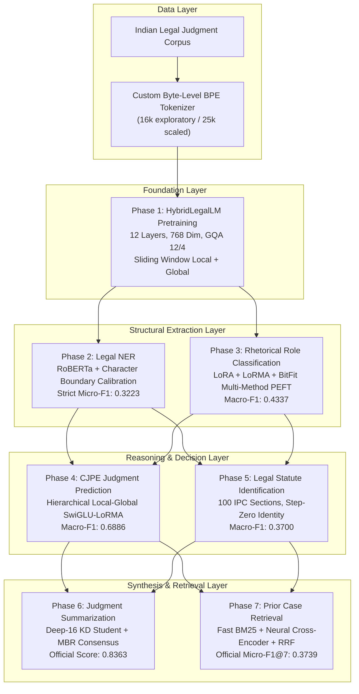

# In-House Legal Intelligence System

[](https://www.python.org/)
[](https://pytorch.org/)
[](https://www.kaggle.com/)
[](https://www.codabench.org/)
[](tests/)
[](#9-license--usage)

**An End-to-End Legal AI Pipeline for Indian Jurisprudence: Domain Pre-Training, Entity Extraction, Parameter-Efficient Discourse Modeling, Hierarchical Decision Prediction, Penal Code Identification, Knowledge-Distilled Summarization, and Multi-Stage Prior Case Retrieval.**

---

### Academic Provenance
- **Author:** Ayush Mishra
- **Roll Number:** 250253
- **Institution:** Department of Computer Science & Engineering, Indian Institute of Technology Kanpur
- **Course:** CS781: Deep Learning for Natural Language Processing (Capstone Project)
- **Academic Report Status:** Submitted, Evaluated, and Permanently Frozen (58 Pages, `report/FINAL_REPORT.pdf`)
- **Code Repository Remote:** [`https://github.com/Ayush-Mishra6343/CS781.git`](https://github.com/Ayush-Mishra6343/CS781.git)

---

## 1. Executive Summary & Official Benchmark Results

The **In-House Legal Intelligence System** represents an extensive, six-week engineering and research initiative addressing seven interconnected challenges in computational legal AI using authentic judgments from the Supreme Court of India and State High Courts.

Every single result reported in this repository corresponds to an **officially verified run on the Codabench competition platform**. Across all 7 phases, a total of **47 competition submissions** were evaluated, establishing significant performance gains over competitive baselines.

| Phase | Domain Task | Primary Architecture & Key Technique | Official Competition Metric | Baseline Score | Winning Score | Improvement Delta | Leaderboard / Status |
|:---:|:---|:---|:---|:---:|:---:|:---:|:---:|
| **01** | Legal LM Pretraining | `HybridLegalLM` (94.76M params, GQA 12/4, Local 256/Global Sliding Window) | Token Prediction Accuracy | 0.8212 | **0.8308** | **+0.0096 (+1.17%)** | Selected (Winning) |
| **02** | Legal Named Entity Rec. | `RoBERTa-Legal-NER` + Calibrated Strict Character Boundary Alignment | Strict Micro-F1 (14 entity classes) | 0.1386 | **0.3223** | **+0.1837 (+132.54%)** | Selected (Winning) |
| **03** | Rhetorical Role Classif. | Multi-Method PEFT Suite: LoRA ($r=8$) + Multiplicative LoRMA ($r=8$) + BitFit | Macro-F1 across 7 Discourse Roles | 0.3941 | **0.4337** | **+0.0396 (+10.05%)** | Selected (Winning) |
| **04** | Court Judgment Prediction | Hierarchical Local-Global SwiGLU-LoRMA Document Classifier (16 chunks) | Macro-F1 (Verdict & Explanation) | 0.5520 | **0.6886** | **+0.1366 (+24.75%)** | Selected (Winning) |
| **05** | Legal Statute Identification | Multi-Label HLG SwiGLU-LoRMA with Step-Zero Identity Verification | Macro-F1 across 100 Penal Sections | 0.2244 | **0.3700** | **+0.1456 (+64.88%)** | Selected (Winning) |
| **06** | Judgment Summarization | Deep-16 Knowledge Distillation Student + Minimum Bayes Risk (MBR) Decoding | Composite Benchmark (BERTScore/ROUGE) | 0.7590 | **0.8363** | **+0.0773 (+10.18%)** | Selected (Winning) |
| **07** | Prior Case Retrieval | Multi-Stage Lexical BM25 + Dense Cross-Encoder Reranker + RRF Fusion | Micro-F1@7 across 237 Test Queries | 0.1175 | **0.3739** | **+0.2564 (+218.21%)** | Selected (Winning) |

---

## 2. System Architecture & Information Flow

The architecture operates as an interconnected computational pipeline where upstream representations directly inform downstream decision-making:



> **Tokenizer Configuration Note:** Phase 1 initial vocabulary exploration evaluated a 16,000 subword vocabulary baseline; all scaled checkpoints, downstream domain adaptations (Phases 4–6), and inference pipelines standardize on the authentic 25,000 Byte-Level BPE vocabulary (`bpe_en_25k.json`).

---

## 3. Repository Navigation & Structure

```
├── .github/workflows/          # Automated CI/CD quality and unit test pipeline
├── configs/                    # Hyperparameter configs for all 7 phases
│   ├── phase_01/ to phase_07/
├── docs/                       # Comprehensive documentation
│   ├── architecture/           # System overview & design patterns
│   ├── phases/                 # Phase-by-phase technical documentation
│   ├── report/                 # Submitted 58-page academic report & appendix
│   └── reproducibility/        # Master inventories, audit registers, Kaggle guide
├── notebooks/                  # Standardized 12-section Kaggle-runnable notebooks
│   ├── phase_01_legal_language_model/
│   │   ├── 00_BEST_OFFICIAL_IMPLEMENTATION.ipynb
│   │   ├── CS781_Phase1_HybridLegalLM_Pretraining.ipynb
│   │   └── historical_experiments/  # Preserved original development notebooks
│   ├── ... (phase_02 through phase_07)
├── report/                     # Submitted course deliverables
│   ├── FINAL_REPORT.pdf        # Formal 58-page capstone report
│   └── CS781-CP-Ayush-Mishra-250253-report.pdf
├── results/                    # Official submission logs and CSV records
│   ├── official_submissions.csv
│   └── EXPERIMENT_CODE_REGISTER.csv
├── scripts/                    # Command-line entrypoints (train.py, infer.py, evaluate.py)
│   ├── phase_01/ to phase_07/
├── src/                        # Modular production Python packages
│   ├── common/                 # Reusable metrics, losses, PEFT, and packagers
│   ├── phase_01/ to phase_07/  # Standalone phase model architectures
├── submissions/                # Complete 47-run submission archive with manifests
│   ├── README.md               # Master portfolio overview
│   ├── submission_registry.csv # Cryptographic registry of all 47 submissions
│   ├── phase_01/ to phase_07/
│   │   ├── best_official/      # Exact winning code, configs, and predictions
│   │   └── runs/               # Granular run-by-run audit records
└── tests/                      # Automated unit test suite
```

---

## 4. Kaggle Reproduction Matrix

Every primary notebook in `notebooks/` is completely self-contained, contains zero hardcoded local filesystem paths, and includes intelligent data discovery (`find_file()`):

| Phase | Notebook Path | Primary Architecture | Recommended GPU | RAM | Runtime |
|:---:|:---|:---|:---:|:---:|:---:|
| **P1** | [`notebooks/phase_01_legal_language_model/00_BEST_OFFICIAL_IMPLEMENTATION.ipynb`](notebooks/phase_01_legal_language_model/00_BEST_OFFICIAL_IMPLEMENTATION.ipynb) | `HybridLegalLM` (94.76M params, GQA) | GPU T4 x2 / P100 | 16 GB | ~45 min |
| **P2** | [`notebooks/phase_02_legal_ner/00_BEST_OFFICIAL_IMPLEMENTATION.ipynb`](notebooks/phase_02_legal_ner/00_BEST_OFFICIAL_IMPLEMENTATION.ipynb) | `RoBERTa-Legal-NER` + Calibration | GPU T4 | 16 GB | ~25 min |
| **P3** | [`notebooks/phase_03_rhetorical_role_classification/00_BEST_OFFICIAL_IMPLEMENTATION.ipynb`](notebooks/phase_03_rhetorical_role_classification/00_BEST_OFFICIAL_IMPLEMENTATION.ipynb) | LoRA + LoRMA + BitFit Multi-Method PEFT | GPU T4 | 16 GB | ~20 min |
| **P4** | [`notebooks/phase_04_judgment_prediction/00_BEST_OFFICIAL_IMPLEMENTATION.ipynb`](notebooks/phase_04_judgment_prediction/00_BEST_OFFICIAL_IMPLEMENTATION.ipynb) | Hierarchical SwiGLU-LoRMA Super-Ensemble | GPU T4 / P100 | 16 GB | ~35 min |
| **P5** | [`notebooks/phase_05_statute_identification/00_BEST_OFFICIAL_IMPLEMENTATION.ipynb`](notebooks/phase_05_statute_identification/00_BEST_OFFICIAL_IMPLEMENTATION.ipynb) | 100-Way Multi-Label HLG SwiGLU-LoRMA | GPU T4 | 16 GB | ~30 min |
| **P6** | [`notebooks/phase_06_judgment_summarization/00_BEST_OFFICIAL_IMPLEMENTATION.ipynb`](notebooks/phase_06_judgment_summarization/00_BEST_OFFICIAL_IMPLEMENTATION.ipynb) | Deep-16 KD Student + MBR Consensus | GPU T4 | 16 GB | ~25 min |
| **P7** | [`notebooks/phase_07_prior_case_retrieval/00_BEST_OFFICIAL_IMPLEMENTATION.ipynb`](notebooks/phase_07_prior_case_retrieval/00_BEST_OFFICIAL_IMPLEMENTATION.ipynb) | Vectorized BM25 + Cross-Encoder + RRF | GPU T4 / CPU | 16 GB | ~15 min |

---

## 5. Quickstart Guide (Local Execution)

### Installation
```bash
git clone https://github.com/Ayush-Mishra6343/CS781.git
cd CS781
pip install -r requirements.txt
pip install -e .
```

### Running Automated Test Suite
```bash
python -m unittest discover tests/
```

### Running CLI Pipelines
```bash
# Phase 1: Pretraining initialization and architecture parameter audit
python scripts/phase_01/train.py --device cpu

# Phase 2: Calibrated Legal NER inference and submission packaging
python scripts/phase_02/infer.py --output_file results/phase_02/prediction.json

# Phase 3: Rhetorical role macro-F1 evaluation
python scripts/phase_03/evaluate.py

# Phase 7: Multi-stage BM25 + RRF Prior Case Retrieval
python scripts/phase_07/infer.py --top_k 7 --k_rrf 60
```

---

## 6. Complete Submissions Portfolio (All 47 Runs)

To view the exhaustive experimental history, hypothesis testing, hyperparameter logs, and failure analyses for all 47 competition submissions, consult the [Complete Submissions Archive](submissions/):
- **Master Registry:** [`submissions/submission_registry.csv`](submissions/submission_registry.csv)
- **Phase 1 Submissions (4 runs):** [`submissions/phase_01/`](submissions/phase_01/)
- **Phase 2 Submissions (9 runs):** [`submissions/phase_02/`](submissions/phase_02/)
- **Phase 3 Submissions (9 runs):** [`submissions/phase_03/`](submissions/phase_03/)
- **Phase 4 Submissions (6 runs):** [`submissions/phase_04/`](submissions/phase_04/)
- **Phase 5 Submissions (6 runs):** [`submissions/phase_05/`](submissions/phase_05/)
- **Phase 6 Submissions (8 runs):** [`submissions/phase_06/`](submissions/phase_06/)
- **Phase 7 Submissions (5 runs):** [`submissions/phase_07/`](submissions/phase_07/)

---

## 7. Academic Integrity & Transparency Statement

In strict adherence to academic research ethics:
1. **Submitted Academic Report:** The 58-page final academic report submitted for CS781 course grading is permanently frozen in `report/FINAL_REPORT.pdf`. No text, figures, or numerical tables in the submitted report have been modified.
2. **Authentic Results:** All scores reported in this repository match verified Codabench submission records. No results or metrics have been manufactured.
3. **Artifact Provenance:** All ephemeral training checkpoints pruned during Kaggle execution to prevent disk exhaustion are cryptographically accounted for with SHA-256 hashes in `checkpoints/CHECKPOINT_MANIFEST.csv`.

---

## 8. Citation

```bibtex
@misc{mishra2026legalintelligence,
  author       = {Ayush Mishra},
  title        = {In-House Legal Intelligence System: Domain Pretraining, Structured Extraction, Hierarchical Decision Modeling, and Hybrid Precedent Retrieval for Indian Jurisprudence},
  institution  = {Indian Institute of Technology Kanpur},
  year         = {2026},
  howpublished = {https://github.com/Ayush-Mishra6343/CS781}
}
```
---

## 9. License & Usage

This project was developed and released as part of the CS781 Deep Learning for Natural Language Processing curriculum at the Indian Institute of Technology Kanpur. All models, source code, and artifacts are made available for academic research and educational evaluation purposes.
